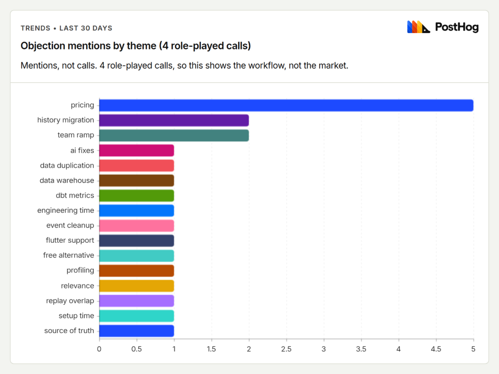

# call-to-card

call-to-card turns sales-call transcripts into draft battlecards, talk tracks, and a running objection log for PMMs and sales teams.

[BRIEF.md](BRIEF.md) explains why I built it and how I'd use it at PostHog to make what we learn on one call useful on the next.

## What you get

One command, one call, three markdown files:

- `battlecards/<competitor>.md`: what they say, what we say, questions that flip it. Only written when a competitor came up.
- `talk-tracks/<topic>.md`: an opener, discovery questions, and the facts the buyer gave us.
- `objections.md`: a running log that counts mentions and calls per theme, so the same worry showing up in 6 calls is obvious.

Every objection also lands in PostHog as an `objection_heard` event, so the log doubles as a live chart.

Where the words go: the transcript is sent to the Claude API to write the drafts. The PostHog events carry the objection theme, the competitor, the call date and the source. They never include the transcript, the buyer's quotes, or the meeting title.



The chart counts mentions, not calls. "Pricing" came up 5 times across 3 of the 4 calls, and the log shows both numbers.

## Quick start

You need Node 20 or newer and a Claude API key.

```
git clone https://github.com/beegrrl/call-to-card
cd call-to-card
npm install
cp .env.example .env    # add ANTHROPIC_API_KEY, and POSTHOG_API_KEY if you want the chart
npm run dev -- --call latest
```

The first `--call` opens your browser to sign in to Granola. After that it remembers you.

## Where calls come from

| Flag | Source | Who it's for |
|---|---|---|
| `--call <id>` or `--call latest` | Granola over MCP | Any paid Granola plan |
| `--api <noteId>` | Granola's REST API | Business and Enterprise workspaces |
| `--file <path>` | A text or markdown transcript | Anyone, with or without Granola |

Other flags: `--out <dir>` (where files go), `--prompt <path>` (try a different prompt), `--force` (run a call again), `--no-telemetry` (skip PostHog).

Running the same call twice does nothing unless you pass `--force`. Your edits to a battlecard or the log are never overwritten; a new call on the same competitor is appended at the bottom for you to fold in.

## The prompt

The prompt is the part worth reading: [`prompts/battlecard.md`](prompts/battlecard.md). It tells the model who is the rep and who is the buyer (Granola labels them Microphone and System audio, and the prompt says that is an assumption about how these calls were recorded, not proof), to keep the buyer's exact words, to write each better answer as something a rep can say out loud, and to name a competitor only when the buyer presents one as an alternative.

v1 wrote advice about the rep instead of words for the rep, and treated the rep's product claims as proof. In [v2](https://github.com/beegrrl/call-to-card/commit/6efd050), I replaced "proof points" with buyer facts, asked for answers a rep could say, and added competitor-specific questions. A rep saying something on a call doesn't make it true.

v3 came out of reviewing the example cards. The evidence rule only covered buyer facts, so the model was still free to invent competitor limitations and setup timelines in the answers. v3 applies it to every answer and every flip question, tells the model that a product in the buyer's existing stack is not a competitor, and asks for a bounded test whenever the call can't support a claim.

## Examples

Four role-played calls, recorded in Granola with a scripted buyer. The raw model output and my edits are separate commits, so the diff shows what the tool got wrong.

| Call | Competitor | Battlecard | Talk track |
|---|---|---|---|
| Already on PostHog, keeping Sentry for errors | Sentry | [sentry.md](examples/battlecards/sentry.md) | [adding-posthog-next-to-sentry.md](examples/talk-tracks/adding-posthog-next-to-sentry.md) |
| Mixpanel renewal went up | Mixpanel | [mixpanel.md](examples/battlecards/mixpanel.md) | [replacing-mixpanel-at-renewal.md](examples/talk-tracks/replacing-mixpanel-at-renewal.md) |
| 9-person startup with nothing but Google Analytics | Google Analytics | [google-analytics.md](examples/battlecards/google-analytics.md) | [predictable-pricing-for-launch.md](examples/talk-tracks/predictable-pricing-for-launch.md) |
| Snowflake and dbt shop, no second copy of the data | Existing stack, not a replacement evaluation | (no card, by design) | [posthog-alongside-snowflake-and-dbt.md](examples/talk-tracks/posthog-alongside-snowflake-and-dbt.md) |

The running log for all four is [examples/objections.md](examples/objections.md). The answers in the log are the model's drafts as generated; the reviewed answers are on the cards, and where they differ, the card wins.

What I fixed by hand: raw output for the Sentry call is [2cc7d31](https://github.com/beegrrl/call-to-card/commit/2cc7d31), my edits are [816f3e9](https://github.com/beegrrl/call-to-card/commit/816f3e9). Raw output for the other three is [278c3ee](https://github.com/beegrrl/call-to-card/commit/278c3ee), my edits are [58319e0](https://github.com/beegrrl/call-to-card/commit/58319e0).

Most of the editing was deciding what we could stand behind, then cutting the duplicate answers.

## One thing I'd change about PostHog's positioning

I'd keep PostHog's context-layer positioning, but make the competitive pitch more specific. The [observability selling guide](https://posthog.com/handbook/growth/use-case-selling/observability) still leans on replay as a distinction from Sentry and leaves its Sentry/Datadog battlecard "To be added", although [PostHog's own comparison](https://posthog.com/compare/posthog-vs-sentry) acknowledges that Sentry has replay. For a team already on PostHog, I'd lead with whether connecting errors to the product behavior they already measure helps them decide what to fix. Then I'd show the workflow, the extra cost, and the cases where keeping Sentry is the better decision. The [Sentry card](examples/battlecards/sentry.md) is my first pass at that conversation, using a role-played call to test the draft.

## What it doesn't do

- No CRM writes. It does not know which deal a call belongs to.
- No rep scoring. It writes better answers, not report cards.
- No decks, no web UI, no hosting. Markdown goes where your handbook already lives.
- It does not read the live PostHog handbook yet, so "what we say" comes from the call and the prompt, not from the docs.

## What's next

- A Granola webhook, so a card appears a few minutes after the call ends instead of when someone remembers to run it.
- Read the live handbook, so "what we say" cites the page it came from.
- A weekly digest from the PostHog events: which objections are climbing, which competitor is showing up more.
- A "this answer didn't work" flag on each objection, so the log learns from the next call.

---

Melissa Thorne · [beegrrl.github.io](https://beegrrl.github.io) · [LinkedIn](https://linkedin.com/in/beegirl) · MIT license
