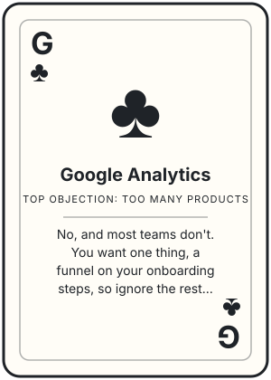

# Google Analytics

## What they say

- **too many products**: "there are like 10 products on your site. Do I need all of this? I just want to know if people finish onboarding."
- **pricing**: "How do I know I won't get a surprise bill? We're launching on Product Hunt next month and if traffic spikes, I can't have a giant invoice."
- **pricing**: "That's exactly what scares me. Scales with me means it scales up when I least expect it."
- **setup time**: "we're 2 engineers, it has to take an afternoon, not a sprint."
- **free alternative**: "why not just use the free version of something simpler? Google Analytics is free."

## What we say

- **too many products**: No, and most teams don't. You want one thing, a funnel on your onboarding steps, so ignore the rest of the site until you have a question that funnel can't answer.
- **pricing**: Fair, and 'scales with you' isn't an answer. Tell me roughly how many users you expect on launch day and I'll show you the bill at that volume. Then we set a billing limit on product analytics before launch. When you hit it, event capture stops until the next month, so we pick that number together.
- **setup time**: Let's test the afternoon instead of me promising it. Add the snippet, send 3 or 4 onboarding events, and build the funnel in the UI. If the funnel isn't showing real users by the end of the day, tell me, and we either fix it together or you walk.
- **free alternative**: Keep Google Analytics for marketing traffic, it's good at that. Your question is about a signed-in user moving through onboarding steps, which is the thing product analytics is built for. PostHog has a free monthly allowance; give me your expected signups and I'll check whether a 4-step funnel stays inside it before you spend anything.

## Questions that flip it

- When someone signs up from a marketing page, can you see in Google Analytics what that same person did in your onboarding, step by step?
- If a user drops off at step 3, can you see which users they were and what they did before that?
- How would you answer 'what percent of signups finish onboarding' with Google Analytics today, and how long would that take?
- When you want to fix the drop-off, would it help to watch a session recording of someone getting stuck, in the same tool as the funnel?

---

Heard in 1 call, last on 2026-11-06
<!-- call:b9f61712-8abf-48c5-8b53-abf81deb4a8d -->
