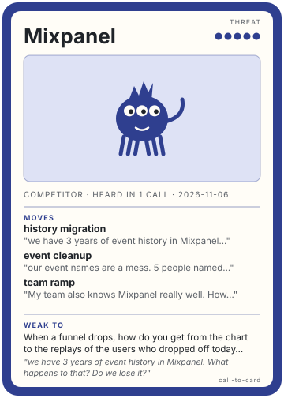

# Mixpanel

## What they say

- **history migration**: "we have 3 years of event history in Mixpanel. What happens to that? Do we lose it?"
- **history migration**: "Straightforward how? 3 years is a lot of data and I don't want to find out halfway through that half of it didn't come over."
- **event cleanup**: "our event names are a mess. 5 people named things 5 different ways over 3 years. Do we have to clean all that up before we move?"
- **team ramp**: "My team also knows Mixpanel really well. How long until they are as fast in a new tool? I can't have the Monday dashboards break."
- **team ramp**: "Everyone says that."
- **pricing**: "I can't tell what I'd pay once we turn on replay and flags on top of analytics."
- **pricing**: "Usage-based means I don't know the number. I need a number before I take this to my CFO."
- **engineering time**: "I don't have an engineer to spare for a month."

## What we say

- **history migration**: You don't lose it. Mixpanel stays live while we run side by side, we import the history, and we compare event counts by month before you switch anything off. I'll send the exact steps and what can't be imported, in writing.
- **event cleanup**: No, you don't have to clean it up first, but the mess comes with you. I'd pick the 10 or so events behind your Monday dashboards, name those properly going forward, and leave the rest alone.
- **team ramp**: Your team will be slower for a couple of weeks, so don't take my word for it. Have them rebuild one Monday dashboard in PostHog while Mixpanel keeps running, and you'll know within a week.
- **pricing**: You'll have a number before you talk to your CFO. Give me your monthly events and the sessions you'd record, and I'll send an estimate for analytics, replay and flags with a low and a high case. You can also set a billing limit on each of those three, and when one hits its limit that product stops collecting until the next period, so the bill can't pass what you approved.
- **engineering time**: I'm not going to promise an hours number before I've seen your setup. Sending events alongside Mixpanel is usually a small install, and your product team can rebuild the dashboards themselves. Give me 30 minutes with whoever owns your tracking and I'll put the engineering estimate in writing before you commit.

## Questions that flip it

- When a funnel drops, how do you get from the chart to the replays of the users who dropped off today, and how long does it take?
- When you ship something behind a flag, how do you measure what it did, and is that in the same tool as the flag?
- What do you pay today for analytics, replay and flags combined, and how much of the renewal increase is Mixpanel alone?
- How much time does your team spend matching the same user across three separate tools?

## Sources

Checked against posthog.com on 2026-11-06. The answers above lean on these, and nothing else.

- History import: [Managed migrations](https://posthog.com/docs/migrate/managed-migrations). One year of data per job, events are not deduplicated, and a paid product analytics plan is required. That is the "what can't be imported, in writing" list.
- Billing limits per product: [Billing limits and alerts](https://posthog.com/docs/billing/limits-alerts). Limits exist for most products and ingestion stops when one is hit. Logs retention is the documented exception.
- Sending events next to Mixpanel: [Install](https://posthog.com/docs/getting-started/install) and [Send events](https://posthog.com/docs/getting-started/send-events). The docs show the snippet and a capture call; the "small install" line is an estimate, not a doc claim, which is why the card asks for 30 minutes before putting a number on it.

---

Heard in 1 call, last on 2026-11-06
<!-- call:b2a6c3e3-94a7-4107-967f-69a977a5000f -->
