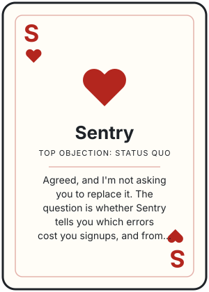

# Sentry

## What they say

- **status quo**: "Sentry works, nobody on my team complains about it."
- **replay overlap**: "But Sentry already shows me a replay attached to the error, so what's actually different?"
- **ai fixes**: "Sentry's AI already proposes fixes and opens pull requests for us, why would I move?"
- **profiling**: "We also lean on Sentry's profiling a lot, do you have that?"
- **pricing**: "so I'd still be paying Sentry, am I saving any money here, or paying for both for 6 months?"
- **flutter support**: "our mobile app is in Flutter, I'm not sure you even support it."
- **data warehouse**: "Our data team is also going to ask whether all of this ends up in Snowflake."

## What we say

- **status quo**: Agreed, and I'm not asking you to replace it. The question is whether Sentry tells you which errors cost you signups, and from what you said, it tells you which ones are loudest.
- **replay overlap**: You're right, a replay on an error is table stakes and Sentry does it well. What Sentry can't show you is how many people hit that error mid-signup and never came back, and that's what decides what you fix first.
- **ai fixes**: Don't move. Sentry's AI fixes are better than what we have, so keep them. Use PostHog to choose which errors are worth sending to that AI in the first place.
- **profiling**: No, we don't do code profiling, and Sentry is the right tool for that. So the real question is whether you need Sentry for profiling only, or for error triage too.
- **pricing**: You'll likely pay for both for a while, so I won't promise savings up front. Give me your monthly error volume and I'll send you a real cost estimate in writing today, so you have a number for finance before the trial starts.
- **flutter support**: We have a Flutter SDK, but I'll confirm in writing today exactly what works for Flutter, including error tracking, so you aren't relying on my memory. If error tracking isn't there yet, we run the trial on your web signup flow.
- **data warehouse**: PostHog can export product data to Snowflake. I'll confirm today whether error events are included and send that with the Flutter answer, so your data team has it up front.

## Questions that flip it

- When Sentry flags an error, how do you find out how many signups or paying users it actually hit?
- Who lines up Sentry exports with your funnels today, and how long does that take?
- Of the errors you fixed last quarter, how many moved a conversion or retention number?
- If an error never spikes in Sentry but quietly blocks signups, how would you catch it today?

---

Heard in 1 call, last on 2026-11-06
<!-- call:7955511b-3f84-4641-8eaf-1fcb7528c4ab -->
